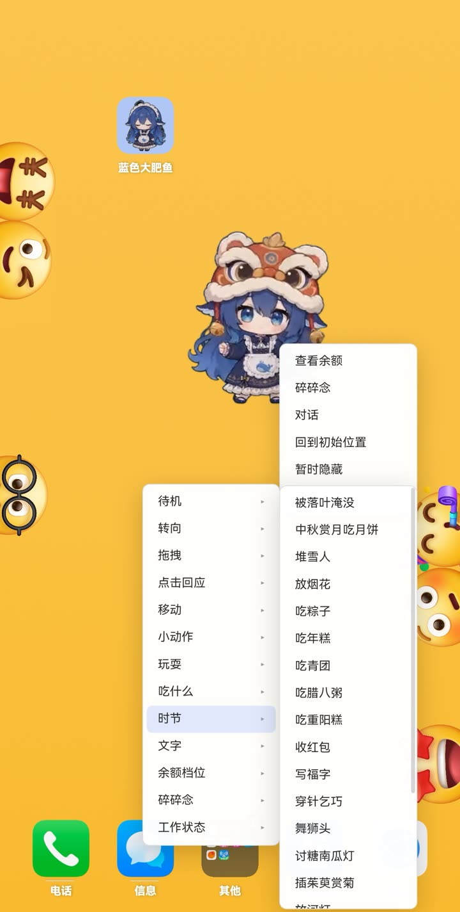
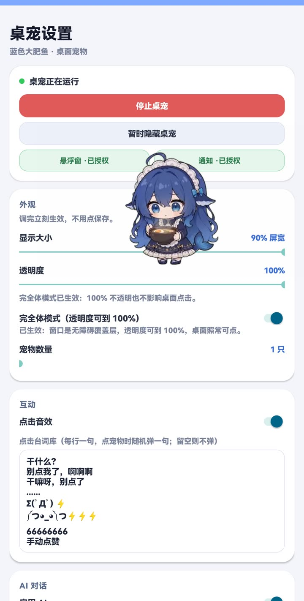

# 蓝色大肥鱼 · dsh-pet-android

把 [dsh-pet](https://github.com/PC2005-cloud/dsh-pet)（DSH 平台的桌面宠物插件）移植成独立 Android 应用：桌面上飘着一只会动、会说话、能拖拽的宠物。

| 桌宠与长按菜单 | 设置页 |
|---|---|
|  |  |

## 使用方法

### 1. 安装

从 [Releases](https://github.com/ldyivan/dsh-pet-android/releases/latest) 下载 APK 安装（Android 8.0 及以上）。首次打开按提示授予两项权限：

- **悬浮窗**（必需）：桌宠要靠它显示在桌面之上
- **通知**：常驻控制条与对话提醒

### 2. 启动桌宠

点「启动桌宠」，宠物出现在桌面。外观项（显示大小、透明度、宠物数量）拖动即生效，不需要点保存。

### 3. 基本操作

- **拖拽**：按住宠物拖动，松手后落回屏幕底部
- **点击**：随机弹一句台词（台词库可在设置页自定义），带点击音效
- **长按**：弹出菜单——查看余额 / 碎碎念 / 对话 / 回到初始位置 / 暂时隐藏，以及待机、小动作、吃什么、时节、文字等动作分类

### 4. 让桌宠一直在（重要）

从最近任务划掉 App 后，桌宠会自动回来（自带三层保活）。但国产 ROM 需要手动放行，否则会被强杀：

1. 设置页 →「后台保活」→ 电池优化：选「允许后台运行」
2. 设置页 →「后台保活」→ 自启动管理：允许本应用自启动
3. 最近任务里给本应用加锁（MIUI / ColorOS 的下拉锁定）

被系统清理后最多 15 分钟内自动回来；手动「强制停止」不会被恢复。

### 5. AI 对话

设置页「AI 对话」填 OpenAI 兼容接口的地址 / 模型 / API Key 即可聊天，回复以气泡显示。不填也能当普通桌宠用。

### 6. 完全体模式

开启后透明度可以到 100% 且不影响桌面点击（需要授予无障碍权限）。切换会重建窗口，宠物位置回到默认。

### 7. 隐藏与停止

- **暂时隐藏**：桌宠不显示，服务仍在运行
- **停止桌宠**：彻底退出，之后不会再被自动拉起

### 8. 检查更新

设置页「关于与更新」会查询本仓库的 Releases，有新版本可直接下载安装。

## 开源引用

本工程直接基于以下开源项目：

- [PC2005-cloud/dsh-pet](https://github.com/PC2005-cloud/dsh-pet)（MIT）——宠物动画、渲染逻辑、台词与素材均来自该项目；本工程新增的是 Android 平台层（悬浮窗、触摸层、前台服务、后台保活、设置页）
- AndroidX Core / AppCompat / Activity、AndroidX WebKit、OkHttp（Apache-2.0）
- 运行时：Android WebView

完整的来源与许可声明见 [NOTICE.md](NOTICE.md)。

## 开源许可

MIT License，见 [LICENSE](LICENSE)。

再分发时请保留 `LICENSE` 中的版权声明，以及 `app/src/main/assets/dsh-pet.js` 末尾的版权注释段。

> 上游项目声明：素材（动画 / 提示词 / 源视频）仅限开源使用，禁止商用。